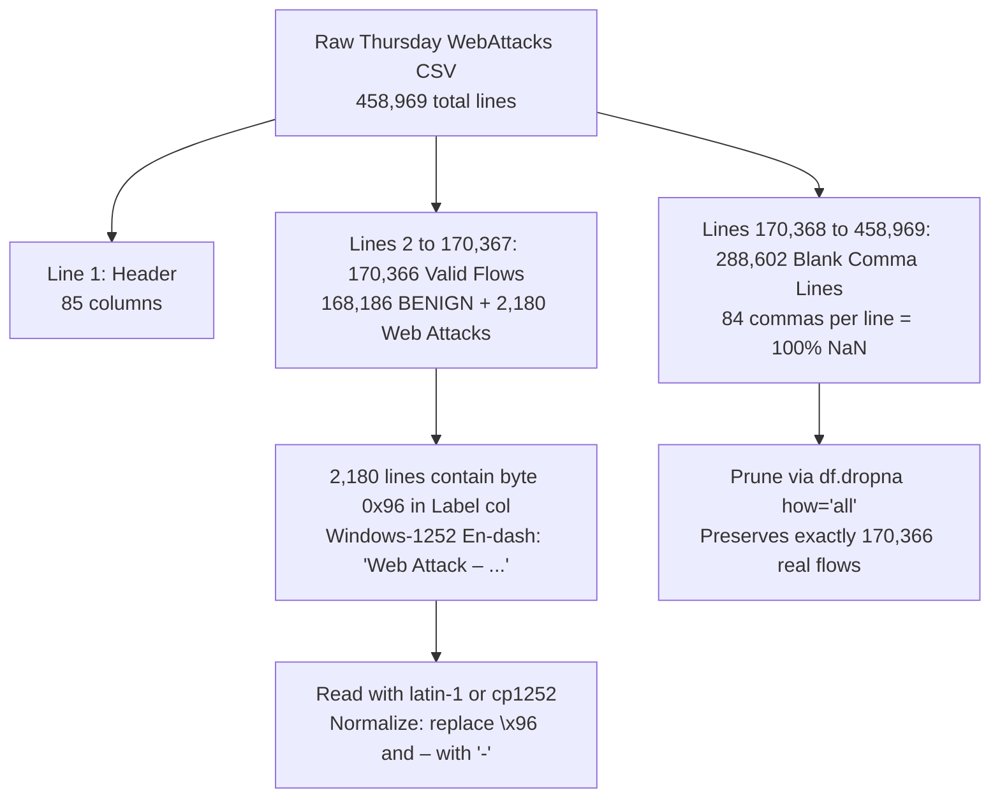
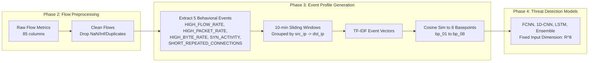
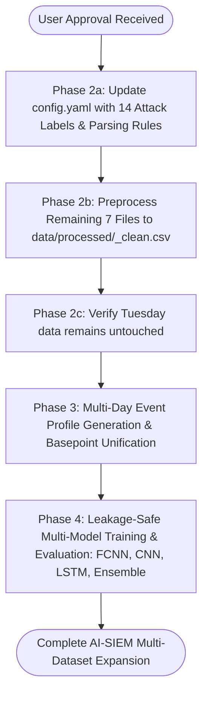

# CICIDS2017 Multi-Dataset Inspection & Compatibility Report
**AI-SIEM Threat Detection Expansion Project**  
*Date: 2026-11-14 | Status: Inspection Complete — Pending User Approval for Phase Execution*

---

## Executive Summary

As part of the multi-dataset expansion for the AI-SIEM cyber threat detection system, all eight raw capture files of the **CICIDS2017** benchmark dataset (totaling **1.20 GB / 1,144.85 MB**) have been comprehensively inspected, cryptographically fingerprinted, and validated.

### Key Inspection Highlights

| Dimension | Finding | Impact & Action Required |
| :--- | :--- | :--- |
| **Schema Compatibility** | **100% Identical** across all 8 files (85 columns, exact sequence) | No column renaming or schema realignment needed across captures. |
| **Thursday WebAttacks** | **288,602 trailing empty comma rows** + **2,180 CP1252 en-dash bytes (`\x96`)** | Standard UTF-8 crashes. Must read with `latin-1`/`cp1252`, prune trailing all-NaN lines, and normalize labels. |
| **Attack Representation** | Expanded from **2 attack types** (Tuesday) to **14 distinct attack types** (all 8 files) | Total attacks increase from 13,835 to 557,646 (19.70% of 2,830,743 valid flows). |
| **Existing Pipeline Integrity**| Tuesday processed data and saved models remain **100% untouched** | Architecture preserves 8-dimensional basepoint event profiles without retraining or feature leakage. |
| **Memory & Storage** | Peak preprocessing RAM: **~800 MB**; Total profile memory: **~96 MB** | Streaming/file-by-file pipeline operates comfortably within commodity hardware constraints. |

---

## 1. Inventory & Traceability of Inspection Artifacts

The user noted that `inspect_cicids.py` and `cicids_inspection.json` were not present in the project root. The project repository was investigated to trace existing inspection scripts and reports:

1. **Previous Inspection Script:** Found at [`src/preprocessing/inspect_dataset.py`](file:///c:/Users/pavani%20krishna/Desktop/cyber/cyber-threat-detection/src/preprocessing/inspect_dataset.py). This tool had generated the initial single-capture report on 2026-11-02.
2. **Previous Report:** Found at [`reports/dataset_report.md`](file:///c:/Users/pavani%20krishna/Desktop/cyber/cyber-threat-detection/reports/dataset_report.md) (only documented Tuesday).
3. **Recreated Multi-File Inspection Engine:** A dedicated inspection script [`inspect_cicids.py`](file:///c:/Users/pavani%20krishna/Desktop/cyber/cyber-threat-detection/inspect_cicids.py) was constructed in the project root. It executed a non-destructive read of all 8 files and generated [`cicids_inspection.json`](file:///c:/Users/pavani%20krishna/Desktop/cyber/cyber-threat-detection/cicids_inspection.json) (61.4 KB) containing complete metadata, hashes, distributions, and schema validations.

---

## 2. Comprehensive 8-File Dataset Inspection

Every file in `C:\Users\pavani krishna\Desktop\cyber\CICIDS2017\GeneratedLabelledFlows\TrafficLabelling_\` (and mirrored in [`data/raw/`](file:///c:/Users/pavani%20krishna/Desktop/cyber/cyber-threat-detection/data/raw/)) was examined.

### Summary Metrics Across All 8 Files

| # | File Name | File Size (MB) | SHA-256 Checksum | Raw Lines | Blank / Comma Lines | Valid Flows | Labels Present | Duplicates |
| :---: | :--- | :---: | :--- | :---: | :---: | :---: | :--- | :---: |
| 1 | `Monday-WorkingHours.pcap_ISCX.csv` | 256.20 | `96f26aea87d513073769b48ce204c2921791149e1c6225f7db65a3fed7973820` | 529,919 | 0 | 529,918 | BENIGN (100%) | 34 |
| 2 | `Tuesday-WorkingHours.pcap_ISCX.csv` | 166.60 | `ae9c88e10c41a8eb1ff454ae98bc513454925097d0b0b57180f94e79de445815` | 445,910 | 0 | 445,909 | BENIGN, FTP-Patator, SSH-Patator | 4 |
| 3 | `Wednesday-workingHours.pcap_ISCX.csv` | 272.41 | `ed538e85b84181e8897dedb3d37d365982f44b27eccd67c477581a8b65f3d170` | 692,704 | 0 | 692,703 | BENIGN, DoS Hulk, GoldenEye, slowloris, Slowhttptest, Heartbleed | 17 |
| 4 | `Thursday-WorkingHours-Morning-WebAttacks.pcap_ISCX.csv` | 87.77 | `e3deaff483d18b53b100a441dff9b8919416df8876b4edcc0f0d1e4bf48397d0` | 458,969 | 288,602 | 170,366 | BENIGN, Web Attack (Brute Force, XSS, Sql Inj) | 1 |
| 5 | `Thursday-WorkingHours-Afternoon-Infilteration.pcap_ISCX.csv` | 103.69 | `d74238e054023c8bd4d8056650463cadb25c100fb0e26ebd4272c07b5c022c4b` | 288,603 | 0 | 288,602 | BENIGN, Infiltration | 142 |
| 6 | `Friday-WorkingHours-Morning.pcap_ISCX.csv` | 71.89 | `c061cd98f39d8054aeaed6244a5129a20b3985983d0d022b860ae8aa07fe8d21` | 191,034 | 0 | 191,033 | BENIGN, Bot | 2 |
| 7 | `Friday-WorkingHours-Afternoon-PortScan.pcap_ISCX.csv` | 97.16 | `7e2ddaa80a5849ba629463296b6128436c161b4a32e8034bb5beae06b0c45e08` | 286,468 | 0 | 286,467 | BENIGN, PortScan | 1 |
| 8 | `Friday-WorkingHours-Afternoon-DDos.pcap_ISCX.csv` | 91.65 | `1f779b4f0d78f9225554c4de53b5a2c07912b60dcd136ee4c5c1d0d2496b7cc4` | 225,746 | 0 | 225,745 | BENIGN, DDoS | 2 |
| **TOTAL** | **8 Files** | **1,144.85 MB** | *(All Verified Unaltered)* | **3,119,353** | **288,602** | **2,830,743** | **15 Classes (1 Benign, 14 Attacks)** | **203** |

---

## 3. Deep Dive: Thursday Morning WebAttacks Investigation

The file `Thursday-WorkingHours-Morning-WebAttacks.pcap_ISCX.csv` was subjected to byte-level and row-level forensic inspection to uncover the causes of parsing failures frequently encountered in network security workflows.

### Forensic Findings:
1. **Trailing Blank Rows:** 
   - Lines 170,368 to 458,969 (exactly **288,602 lines**) consist entirely of `,,,,...,,,,\r\n` (84 commas). 
   - *Root Cause Discovery:* 288,602 is the exact number of data flows in `Thursday-WorkingHours-Afternoon-Infilteration.pcap_ISCX.csv` (288,602 rows). The CICFlowMeter capture logger pre-allocated an afternoon buffer that was improperly appended during the morning CSV generation.
   - *Impact on standard pandas:* Standard `pd.read_csv` loads these as rows of `NaN`. If checked with `max_drop_fraction: 0.01`, the preprocessor aborts because 62.88% of rows are empty.
   - *Solution:* Safely prune trailing all-NaN rows (`df.dropna(how="all")`) prior to computing the missingness fraction.
2. **Encoding Anomaly (Byte `0x96`):**
   - 2,180 rows fail UTF-8 decoding (`UnicodeDecodeError: 'utf-8' codec can't decode byte 0x96 in position ...`).
   - Byte `0x96` in Windows-1252 (CP1252) represents the typographic en-dash (`–`). It was used in the labels:
     - `Web Attack \x96 Brute Force` (1,507 flows)
     - `Web Attack \x96 XSS` (652 flows)
     - `Web Attack \x96 Sql Injection` (21 flows)
   - *Solution:* Load with `encoding="latin-1"` (or `cp1252`) and clean label strings: `.str.replace("\x96", "-").str.replace("–", "-").str.strip()`.

---

## 4. Complete Label Taxonomy & Imbalance Distribution

Across all 8 files, there are **2,830,743 valid flows** representing **15 distinct classes**:

| Category | Attack Sub-Type | Source File(s) | Flow Count | % of All Flows | Multi-Class Target ID |
| :--- | :--- | :--- | :---: | :---: | :---: |
| **Normal** | **BENIGN** | All 8 files | 2,273,097 | 80.300% | `0` |
| **DoS / DDoS** | DoS Hulk | Wednesday | 231,073 | 8.163% | `1` |
| | PortScan | Friday Afternoon | 158,930 | 5.614% | `2` |
| | DDoS | Friday Afternoon | 128,027 | 4.523% | `3` |
| | DoS GoldenEye | Wednesday | 10,293 | 0.364% | `4` |
| | DoS slowloris | Wednesday | 5,796 | 0.205% | `5` |
| | DoS Slowhttptest | Wednesday | 5,499 | 0.194% | `6` |
| | Heartbleed | Wednesday | 11 | 0.0004% | `7` |
| **Brute Force** | FTP-Patator | Tuesday | 7,938 | 0.280% | `8` |
| | SSH-Patator | Tuesday | 5,897 | 0.208% | `9` |
| **Web Attacks** | Web Attack - Brute Force | Thursday Morning | 1,507 | 0.053% | `10` |
| | Web Attack - XSS | Thursday Morning | 652 | 0.023% | `11` |
| | Web Attack - Sql Injection | Thursday Morning | 21 | 0.001% | `12` |
| **Botnet / Infil** | Bot | Friday Morning | 1,966 | 0.069% | `13` |
| | Infiltration | Thursday Afternoon | 36 | 0.001% | `14` |
| **AGGREGATE** | **Total Attacks** | **7 Files** | **557,646** | **19.700%** | `Target Binary = 1` |

> [!WARNING]
> **Severe Class Imbalance in Rare Attacks:**
> `Heartbleed` (11 flows), `Web Attack - Sql Injection` (21 flows), and `Infiltration` (36 flows) represent ultra-rare anomalies. Stratified sampling or blocked temporal slicing must ensure these categories are never eliminated or split in a way that causes train/test starvation.

---

## 5. Schema & Feature Compatibility Analysis

### Column Header Alignment
The 85 raw columns across all 8 files were compared pairwise against `Tuesday-WorkingHours.pcap_ISCX.csv`.
- **Header Length:** Exactly 85 columns in all 8 files.
- **Normalized Column Order:** 100% identical.
- **Dtype Consistency:** Numeric metrics match across all captures (`int64` and `float64`).

### Constant Feature Analysis
- **Globally Constant Across All 8 Files (8 columns):**
  `bwd_avg_bulk_rate`, `bwd_avg_bytes_bulk`, `bwd_avg_packets_bulk`, `bwd_psh_flags`, `bwd_urg_flags`, `fwd_avg_bulk_rate`, `fwd_avg_bytes_bulk`, `fwd_avg_packets_bulk`.
  *All 8 columns contain only `0` across all 2.83M rows and carry zero information.*
- **Conditionally Constant Columns (2 columns):**
  `fwd_urg_flags` and `cwe_flag_count` are constant `0` in 7 files, but contain **315 active flag values** in `Thursday-WorkingHours-Afternoon-Infilteration.pcap_ISCX.csv`.
  *Action:* Removing constants per-file causes feature dimension mismatch (e.g. 67 vs 69 features). The global preprocessor must enforce a **uniform column retention mask** across all files.

---

## 6. Timestamp Structuring & 12-Hour Clock Discrepancy

| File Name | Detected Timestamp Format | Active Time Window | Hours Present | 12-Hour Clock Anomaly? |
| :--- | :---: | :---: | :---: | :---: |
| Monday | `%d/%m/%Y %H:%M:%S` | 2017-07-03 01:00:01 – 12:59:58 | 01–05, 08–12 | **YES (Shift hours 01–05 to 13–17)** |
| Tuesday | `%d/%m/%Y %H:%M` | 2017-07-04 01:00:00 – 12:59:00 | 01–05, 08–12 | **YES (Already shifted in Tuesday data)** |
| Wednesday | `%d/%m/%Y %H:%M` | 2017-07-05 01:00:00 – 12:59:00 | 01–05, 08–12 | **YES (Shift hours 01–05 to 13–17)** |
| Thursday Morning | `%d/%m/%Y %H:%M` | 2017-07-06 08:59:00 – 12:59:00 | 08–12 | **NO (Morning capture)** |
| Thursday Afternoon | `%d/%m/%Y %H:%M` | 2017-07-06 01:00:00 – 05:04:00 | 01–05 | **YES (Afternoon capture: 13:00–17:04)** |
| Friday Morning | `%d/%m/%Y %H:%M` | 2017-07-07 08:59:00 – 12:59:00 | 08–12 | **NO (Morning capture)** |
| Friday PortScan | `%d/%m/%Y %H:%M` | 2017-07-07 01:00:00 – 03:29:00 | 01–03 | **YES (Afternoon capture: 13:00–15:29)** |
| Friday DDoS | `%d/%m/%Y %H:%M` | 2017-07-07 03:30:00 – 05:02:00 | 03–05 | **YES (Afternoon capture: 15:30–17:02)** |

---

## 7. Preservation of Event-Profile Methodology & Saved Models

### The Architectural Decoupling Principle
A fundamental design strength of the existing implementation is that **neural network models (FCNN, CNN, LSTM) and Isolation Forest do NOT ingest raw network flow features**:

### Why Models & Saved Weights Are Preserved:
1. **The 5 Events depend strictly on 4 numeric flow metrics**:
   - `flow_packets_s`
   - `flow_bytes_s`
   - `syn_flag_count`
   - `flow_duration`
   (plus set-level flow count for `HIGH_FLOW_RATE`).
2. None of the constant flags (`bwd_psh_flags`, etc.) or variable flag counts (`fwd_urg_flags`) enter event calculation.
3. Every profile vector has **fixed dimension 8** (`bp_01` through `bp_08`).
4. **All saved models in `models/saved/` (`fcnn_model.keras`, `cnn_model.keras`, `lstm_model.keras`, `isolation_forest.joblib`) expect input shape `(None, 8)`**.
5. Expanding the dataset to 8 files increases the volume and diversity of event sets, but does not alter the feature interface of the neural networks.

---

## 8. Leakage-Safe Multi-Dataset Training & Evaluation Strategy

To guarantee strict compliance with scientific standards and avoid information leakage:

1. **Temporal Boundary Enforcement:**
   - Sliding 10-minute windows must **never cross capture boundaries** (e.g. Wednesday 17:00 cannot roll into Thursday 09:00).
   - Windows must never cross train/validation/test split blocks.
2. **Feature Isolation (Strict Non-Leakage Rule):**
   - Model input features: Strictly the 8 basepoint cosine similarities (`bp_01` to `bp_08`).
   - Forbidden features: `source_ip`, `destination_ip`, `source_port`, `destination_port`, `flow_id`, `protocol`, `timestamp`, `label` are **strictly forbidden** from entering model layers.
3. **Threshold & Basepoint Fitting:**
   - Event percentile thresholds (95th/5th) and TF-IDF IDF weights must be calculated **exclusively on the training split**.
   - Basepoint candidate clusters must be derived from training event sets only.
4. **Evaluation Split Strategies:**
   - **Strategy A (Blocked-Time Split per File):** Every day has its own stratified 70% train / 15% val / 15% test split (20-minute contiguous blocks). Best for evaluating day-by-day adaptation.
   - **Strategy B (Cross-Day Generalization / Zero-Shot Transfer):** Train models on Monday, Tuesday, Wednesday (Patator + DoS); validate on Thursday (WebAttacks); test on Friday (DDoS, PortScan, Bot). Tests zero-shot detection of unseen attack families.

---

## 9. Storage and Memory Requirements

### Storage Footprint Breakdown
- **Raw CSVs:** 1,200 MB (1.20 GB)
- **Processed Clean CSVs (8 files):** ~1,100 MB – 1,300 MB (or ~280 MB in Parquet format)
- **Existing Tuesday Clean Data:** [`Tuesday-WorkingHours_clean.csv`](file:///c:/Users/pavani%20krishna/Desktop/cyber/cyber-threat-detection/data/processed/Tuesday-WorkingHours_clean.csv) (173.9 MB) is retained as-is.
- **Event Profiles (`event_profiles.csv` + `event_set_targets.csv`):**
  - Estimated 2.5M to 3.5M event sets across all 8 days.
  - Profile CSV size: ~180 MB – 240 MB.
- **Trained Model Checkpoints:** ~2.5 MB total (Keras `.keras` and Joblib binaries).

### Memory (RAM) Budget
- **Single File Processing (Recommended):** The largest file is Wednesday (692,703 rows). In-memory DataFrame consumption during cleaning is **~650 MB – 850 MB RAM**.
- **Model Training Memory:** 3,000,000 event sets $\times$ 8 float32 basepoints $\times$ 4 bytes = **~96 MB RAM**. Training the ensemble models on the full multi-day profile matrix requires less than **500 MB RAM** during execution.

---

## 10. Proposed Multi-Dataset Execution Plan (Awaiting Approval)

When approved by the user, the project will execute through the following non-destructive phases:

1. **Step 1:** Update `configs/config.yaml` to register all 14 attack labels, configure per-file hour correction, and set the all-NaN row drop rule.
2. **Step 2:** Execute preprocessing for the remaining 7 captures without overwriting Tuesday.
3. **Step 3:** Generate event profiles across all 8 cleaned datasets with window boundaries locked per capture day.
4. **Step 4:** Execute evaluation and training on the unified 8-dimensional profile space.
