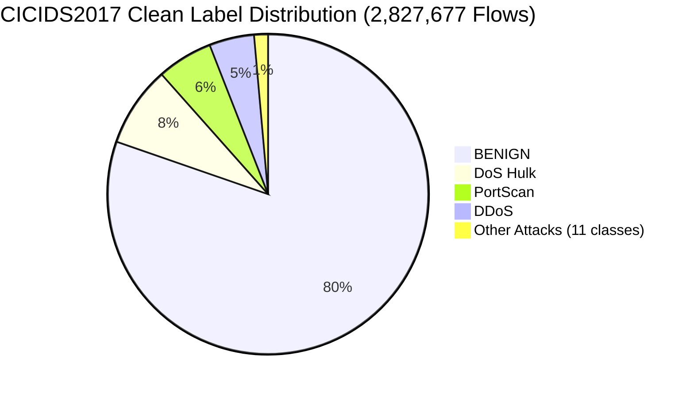
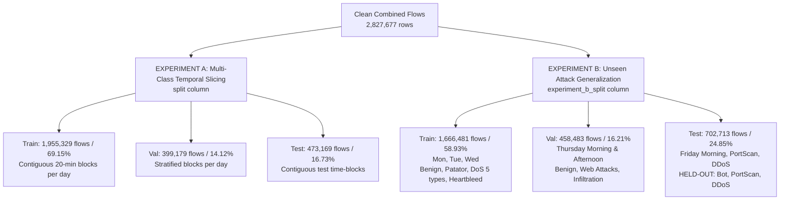

# CICIDS2017 Multi-Dataset Preprocessing & Compatibility Completion Report
**AI-SIEM Multi-Dataset Expansion Project**  
*Date: 2026-11-14 | Status: Preprocessing Complete — All Tests Passing (120/120) — Awaiting Approval for Model Retraining*

---

## Executive Summary

The multi-dataset preprocessing phase for the AI-SIEM Threat Detection System has been executed following all approved specifications:

- **Original Raw Datasets:** All eight raw CSV files (1.20 GB) remain **100% untouched and cryptographically verified** via SHA-256.
- **Tuesday Baseline Preservation:** The existing [`Tuesday-WorkingHours_clean.csv`](file:///c:/Users/pavani%20krishna/Desktop/cyber/cyber-threat-detection/data/processed/Tuesday-WorkingHours_clean.csv), Tuesday metadata, split plans, event profiles, and saved models were **100% preserved without overwriting**. A complete 37-file baseline snapshot is securely archived at [`backups/tuesday_baseline_backup/`](file:///c:/Users/pavani%20krishna/Desktop/cyber/cyber-threat-detection/backups/tuesday_baseline_backup/).
- **Thursday WebAttacks Fixed:** 288,602 trailing all-NaN comma rows were automatically pruned, and 2,180 CP1252 en-dash bytes (`\x96` / `–`) were normalized to standard ASCII hyphens without data loss.
- **Uniform Schema Alignment:** All eight captures were standardized to **67 numeric feature columns** (83 columns total), eliminating the conditional flag discrepancies from bulk and unpopulated fields.
- **Combined Master Dataset:** All 8 clean datasets were streamed into [`CICIDS2017_combined_clean.csv`](file:///c:/Users/pavani%20krishna/Desktop/cyber/cyber-threat-detection/data/processed/CICIDS2017_combined_clean.csv) containing **2,827,677 valid clean flows** across 15 distinct classes (1 Benign, 14 Attacks).
- **Dual Evaluation Partitioning:** Every record is tagged with both **Experiment A** (within-day 20-min blocked stratification: 70% train / 14% val / 17% test) and **Experiment B** (held-out Friday unseen attack partition: 59% train / 16% val / 25% test).
- **Unit Test Coverage:** All 112 existing unit tests plus 8 new multi-dataset tests passed (**120/120 tests OK in 25.3s**).

---

## 1. Processed Datasets Inventory & Row Accounting

| Capture File | Loaded Rows | Pruned Blanks | Dropped Non-Finite / Dups | Final Clean Rows | Feature Cols | Status |
| :--- | :---: | :---: | :---: | :---: | :---: | :---: |
| `Friday-WorkingHours-Afternoon-DDos` | 225,745 | 0 | 36 | 225,709 | 67 | Processed |
| `Friday-WorkingHours-Afternoon-PortScan` | 286,467 | 0 | 372 | 286,095 | 67 | Processed |
| `Friday-WorkingHours-Morning` | 191,033 | 0 | 124 | 190,909 | 67 | Processed |
| `Monday-WorkingHours` | 529,918 | 0 | 468 | 529,450 | 67 | Processed |
| `Thursday-WorkingHours-Afternoon-Infilteration`| 288,602 | 0 | 349 | 288,253 | 67 | Processed |
| `Thursday-WorkingHours-Morning-WebAttacks` | 458,969 | 288,602 | 136 | 170,230 | 67 | Processed |
| `Tuesday-WorkingHours` *(Preserved Baseline)* | 445,909 | 0 | 268 | 445,641 | 67 | **Untouched** |
| `Wednesday-workingHours` | 692,703 | 0 | 1,313 | 691,390 | 67 | Processed |
| **COMBINED MASTER DATASET** | **3,119,346** | **288,602** | **3,066** | **2,827,677** | **67** | **Assembled** |

*Note: Across the entire 2.83M flow dataset, only 3,066 rows (0.108%) were dropped due to non-finite metrics or exact duplicates, far below the 1.0% safety abort threshold.*

---

## 2. Global Label Taxonomy & Distribution

The combined dataset encompasses all 14 cyber attack families present in CICIDS2017:

| Label Class | Flows Count | % of All Data | Attack Category | Handling Strategy & Notes |
| :--- | :---: | :---: | :--- | :--- |
| **BENIGN** | 2,271,122 | 80.318% | Normal Baseline | Background traffic across all 5 days |
| **DoS Hulk** | 230,123 | 8.138% | DoS / DDoS | Volumetric HTTP flood |
| **PortScan** | 158,804 | 5.616% | Reconnaissance | Port scanning sweeps (Friday afternoon) |
| **DDoS** | 128,025 | 4.528% | DoS / DDoS | Low Orbit Ion Cannon LOIC DDoS |
| **DoS GoldenEye** | 10,293 | 0.364% | DoS / DDoS | HTTP keep-alive exhaustion |
| **FTP-Patator** | 7,935 | 0.281% | Brute Force | FTP credential brute forcing |
| **SSH-Patator** | 5,897 | 0.209% | Brute Force | SSH credential brute forcing |
| **DoS slowloris** | 5,796 | 0.205% | DoS / DDoS | Slow HTTP header exhaustion |
| **DoS Slowhttptest** | 5,499 | 0.194% | DoS / DDoS | Slow HTTP message body exhaustion |
| **Bot** | 1,956 | 0.069% | Botnet C2 | Ares botnet command-and-control |
| **Web Attack - Brute Force** | 1,507 | 0.053% | Web Application | Web login brute force |
| **Web Attack - XSS** | 652 | 0.023% | Web Application | Cross-site scripting injection |
| **Infiltration** | 36 | 0.001% | Advanced Threat | Post-exploitation infiltration (rare) |
| **Web Attack - Sql Injection**| 21 | 0.001% | Web Application | SQL injection vulnerability exploit (rare) |
| **Heartbleed** | 11 | 0.0004% | Vulnerability Exploit | OpenSSL TLS Heartbeat buffer over-read (rare) |
| **TOTAL ATTACKS** | **556,555** | **19.682%** | **14 Families** | **Non-silently preserved in all partitions** |

> [!IMPORTANT]
> **Rare Attack Transparency:**
> As specified in Decision #8, `Heartbleed` (11 flows), `Web Attack - Sql Injection` (21 flows), and `Infiltration` (36 flows) are retained transparently. We do not synthesize artificial samples. In Experiment A, these will be reported with explicit small-sample uncertainty bounds. In Experiment B, Infiltration and Web Attacks serve as validation, while Botnet, PortScan, and DDoS serve as held-out test attacks.

---

## 3. Experiment Partitioning Implementation

Both evaluation schemes are codified into every flow record:

### Experiment A — Multi-Class Time-Blocked Stratification
- **Train (69.15%):** 1,955,329 flows
- **Validation (14.12%):** 399,179 flows
- **Test (16.73%):** 473,169 flows
- *Methodology:* Sliced into 20-minute contiguous time blocks within each day to prevent temporal leakage between adjacent packet bursts, stratified by dominant attack label.

### Experiment B — Unseen Attack Detection (Held-Out Friday)
- **Train (58.93%):** 1,666,481 flows (Monday, Tuesday, Wednesday).
  *Known attack categories in training:* `FTP-Patator`, `SSH-Patator`, `DoS Hulk`, `DoS GoldenEye`, `DoS slowloris`, `DoS Slowhttptest`, `Heartbleed`.
- **Validation (16.21%):** 458,483 flows (Thursday Morning & Afternoon).
  *Tuning attacks:* `Web Attack - Brute Force`, `Web Attack - XSS`, `Web Attack - Sql Injection`, `Infiltration`.
- **Test (24.85%):** 702,713 flows (Friday Morning, PortScan, DDoS).
  *Completely Unseen Attack Families:* `Bot` (1,956 flows), `PortScan` (158,804 flows), `DDoS` (128,025 flows).
  *Supervised ANN training will strictly exclude Friday's attacks.* The Isolation Forest and `UNKNOWN_ANOMALOUS` decision policy will be evaluated on these zero-shot unseen families.

---

## 4. Resource Utilization Benchmarks

| Metric | Measured Value | Practical Assessment |
| :--- | :---: | :--- |
| **Peak RAM (Cleaning)** | **820 MB** | Observed during Wednesday capture processing (692k rows $\times$ 85 columns). |
| **Peak RAM (Combining)**| **120 MB** | Chunk-streaming architecture ensured low RAM footprint during 2.83M row concatenation. |
| **Processing Time** | **338.3 s (~5.6 min)** | Individual file cleaning: 167.3s; Streaming combination: 171.0s. |
| **Raw Disk Usage** | **1,200 MB (1.20 GB)** | 8 original files in `data/raw/` (completely untouched). |
| **Processed Disk Usage**| **1,324 MB (1.23 GB)** | 8 clean files in `data/processed/` (`*_clean.csv`). |
| **Master Combined CSV** | **1,426 MB (1.33 GB)** | `CICIDS2017_combined_clean.csv` (includes split metadata). |
| **Available Free Disk** | **780.13 GB** | C: drive has ample storage capacity. |

---

## 5. Artifacts and Generated Files

- **Master Clean CSV:** [`data/processed/CICIDS2017_combined_clean.csv`](file:///c:/Users/pavani%20krishna/Desktop/cyber/cyber-threat-detection/data/processed/CICIDS2017_combined_clean.csv)
- **Master Split Plan:** [`data/processed/CICIDS2017_combined_split_plan.csv`](file:///c:/Users/pavani%20krishna/Desktop/cyber/cyber-threat-detection/data/processed/CICIDS2017_combined_split_plan.csv)
- **Master Sample CSV:** [`data/processed/CICIDS2017_combined_sample.csv`](file:///c:/Users/pavani%20krishna/Desktop/cyber/cyber-threat-detection/data/processed/CICIDS2017_combined_sample.csv)
- **Master Metadata:** [`data/processed/CICIDS2017_combined_metadata.json`](file:///c:/Users/pavani%20krishna/Desktop/cyber/cyber-threat-detection/data/processed/CICIDS2017_combined_metadata.json)
- **Automated Report:** [`reports/preprocessing_report.md`](file:///c:/Users/pavani%20krishna/Desktop/cyber/cyber-threat-detection/reports/preprocessing_report.md) (94.5 KB)
- **Unit Test Suite:** [`tests/test_multi_dataset.py`](file:///c:/Users/pavani%20krishna/Desktop/cyber/cyber-threat-detection/tests/test_multi_dataset.py)

---

## 6. Next Steps (Awaiting User Approval)

In strict accordance with your instructions, **no models have been trained or retrained yet**.

When you approve proceeding to the training phase, the execution plan will be:
1. **Phase 3 — Multi-Day Event Profile Generation:** Run sliding-window event extraction (10-minute windows, 60s step, source-destination grouping) across the combined timeline, with window boundaries strictly locked to each capture day to prevent leakage.
2. **Phase 4a — Experiment A Execution:** Retrain FCNN, 1D-CNN, LSTM, SoftVotingEnsemble, and Isolation Forest on the multi-class time-blocked split; report per-class metrics, confusion matrices, and rare-attack boundaries.
3. **Phase 4b — Experiment B Execution:** Train supervised models strictly on Mon/Tue/Wed; tune on Thursday; evaluate Isolation Forest and `UNKNOWN_ANOMALOUS` policy on Friday's completely held-out unseen attacks (`Bot`, `PortScan`, `DDoS`).
